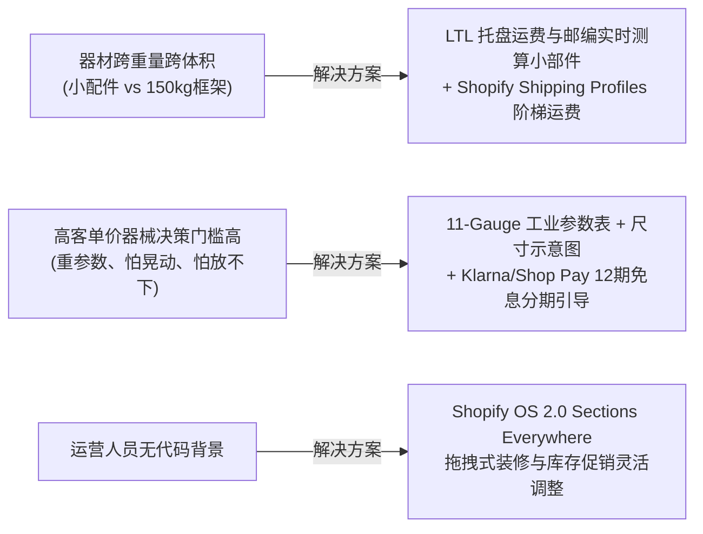

# AURA FORGE - 健身器材 DTC 独立站 (Shopify OS 2.0)

[](https://shopify.dev/docs/themes)
[](https://shopify.dev/docs/themes/tools/cli)
[](https://nodejs.org/)
[-brightgreen)](https://shopify.dev/docs/themes/tools/theme-check)

**AURA FORGE** 是一个专为硬核力量训练、商用及家庭健身房器材打造的专业 DTC（Direct-to-Consumer）高端独立站项目。基于 Shopify Online Store 2.0 架构与官方核心，针对健身器械跨品类、跨重量、大件托盘运输及参数化高客单价决策的行业痛点，提供了完整的现代视觉系统、交互原型以及定制主题代码。

---

## 目录

- [一、核心业务特色与解决方案](#一核心业务特色与解决方案)
- [二、项目目录结构](#二项目目录结构)
- [三、视觉系统与设计规范 (Design System)](#三视觉系统与设计规范-design-system)
- [四、快速开始与本地开发 (Getting Started)](#四快速开始与本地开发-getting-started)
- [五、主题定制开发说明 (Theme Features)](#五主题定制开发说明-theme-features)
- [六、实施路线图与交付状态 (Roadmap)](#六实施路线图与交付状态-roadmap)

---

## 一、核心业务特色与解决方案



1. **大件物流（LTL Freight）vs 轻量配件运费分流**：
   - 针对 50kg~200kg 重型深蹲架与成套杠铃，集成专线卡车托盘派送提示；
   - 商品详情页原生嵌入 **LTL Freight 邮编实时测算组件**，输入美国当地 Zip Code 即可计算运费和 3-5 天送达预估；
   - 轻量配件支持满额包邮阶梯规则。
2. **重工硬核与现代极简力量美学**：
   - 采用炭黑（Carbon Black `#0F1115`）、工业钢灰（`#1E293B`）作为基底，配合高能战术橙（Volt Orange `#F97316`）引导核心 CTA 转化；
   - 等宽字体规范化呈现 11-Gauge（3mm 壁厚）、3"x3" 立柱及 1000kg 极限承重参数。
3. **真实买家评测与社交背书**：
   - 内置轻量化评测体系，原生兼容 Judge.me / Loox；
   - 支持 Google Rich Snippets 结构化数据，搜索结果直接展现 4.95 星好评与评价数量。
4. **全站 OS 2.0 无代码模块化**：
   - 首页、PDP 详情页均全面组件化，支持在 Shopify 后台 Theme Customizer 中自由拖拽排序。

---

## 二、项目目录结构

```text
shopify_demo/
├── README.md                           # 本项目总览与开发维护指南
├── 需求.md                              # 初始业务需求文档
├── 详细需求规格说明书.md                  # 完整产品需求规格说明书 (PRD)
├── 阶段1_视觉与原型设计规范.md            # 品牌视觉体系、调色板与导航规范说明书
├── prototype.html                      # 高保真可交互原型系统 (双击即可浏览器运行)
└── aura-forge-theme/                   # Shopify OS 2.0 独立主题源代码工程
    ├── assets/
    │   ├── aura-forge-custom.css       # 品牌专属样式、徽章与动效样式表
    │   └── ...                         # 核心样式与 JS 资源
    ├── config/
    │   ├── settings_data.json          # 主题调色板、抽屉购物车与全局配置
    │   └── settings_schema.json        # 主题后台可配置项 Schema
    ├── layout/
    │   └── theme.liquid                # 主题全局母版
    ├── sections/
    │   ├── hero-banner-motivating.liquid # 高燃全宽 Hero 横幅 (双 CTA/遮罩控制)
    │   ├── trust-signals-bar.liquid    # 四大硬核信任背书栏 (11-Gauge/托盘送达)
    │   ├── category-showcase-grid.liquid # 力量/有氧/配件三大分类入口卡片
    │   ├── pdp-specs-table.liquid      # 器材工业规格参数对比表
    │   ├── pdp-customer-reviews.liquid # 客户真实评测模块
    │   └── ...                         # 官方基础分区
    ├── snippets/
    │   ├── shipping-freight-calculator.liquid # 大件 LTL 托盘运费实时测算组件
    │   ├── customer-reviews-judge.liquid      # 评测展示与富文本星级组件
    │   └── ...                         # 官方组件与辅助代码
    └── templates/
        ├── index.json                  # 模块化首页模板
        ├── product.json                # 强化版商品详情页模板 (含大件物流块)
        └── ...                         # 其他页面 JSON 模板
```

---

## 三、视觉系统与设计规范 (Design System)

| 颜色角色 | Hex 色值 | 用途与规范 |
| :--- | :--- | :--- |
| **Carbon Black (炭黑)** | `#0F1115` | Hero 背景、导航栏、主标题文字，沉稳工业感 |
| **Volt Orange (战术橙)** | `#F97316` | 核心购买按钮 (Add to Cart)、高亮文字、焦点状态 |
| **Steel Gray (钢灰)** | `#1E293B` | 次级卡片背景、模块分隔边框 |
| **Pure Off-White (极简白)** | `#F8FAFC` | 页面底色、参数规格表格底色 |
| **Freight Amber (物流橙)** | `#D97706` | LTL 大件货运专线警示、运费测算结果徽章 |
| **Review Gold (评测金)** | `#F59E0B` | 5 星好评统计与买家秀星级 |

---

## 四、快速开始与本地开发 (Getting Started)

### 1. 环境准备
确保本机已安装 Node.js 及 Shopify CLI：
```bash
# 检查 Node 版本 (推荐 >= 20.10.0)
node -v

# 检查 Shopify CLI 版本
shopify version
```

### 2. 预览高保真交互原型
项目内置了免安装的单文件 HTML 交互原型系统，涵盖桌面宽屏与移动端（390px）自适应视图：
```bash
# 在默认浏览器中直接打开原型
open prototype.html
```

### 3. 启动主题本地热重载开发服务器
进入主题目录并关联您的 Shopify 合作伙伴开发店铺：
```bash
cd aura-forge-theme

# 启动本地开发服务 (支持实时热重载 Preview)
shopify theme dev --store=your-store.myshopify.com
```

### 4. 运行代码规范检查
执行 Shopify 官方 Theme Check 确保代码 100% 合规：
```bash
cd aura-forge-theme
shopify theme check
```
*(当前状态：162 files inspected, 0 errors)*

---

## 五、主题定制开发说明 (Theme Features)

### 1. 首页模块化配置 (`templates/index.json`)
- **AURA 高燃 Hero 横幅**：支持高清设备大图/视频遮罩，可配置主副标题、顶部徽章、双 CTA 按钮；
- **四大信任背书栏**：展示“11-Gauge 工业钢材”、“专业 LTL 托盘送达”、“终身框架质保”、“4.9 好评认证”；
- **核心品类卡片网格**：力量训练（Strength）、有氧器械（Cardio）、配件周边（Accessories），带悬停微动动效。

### 2. 商品详情页优化 (`templates/product.json`)
- **大件物流运费测算块（`freight_calculator`）**：作为原生 Block 深度集成到产品购买区，提供即时测算体验；
- **工业规格参数表（`pdp-specs-table`）**：规范呈现管材厚度、占地面积、承重极限等技术参数；
- **Ajax 抽屉购物车（Slide-out Cart Drawer）**：加购无需跳转，直接滑出侧边栏，减少弃单率。

---

## 六、实施路线图与交付状态 (Roadmap)

- [x] **阶段 1：视觉与原型规划**
  - [x] 确立品牌视觉规范（调色板、字体排版、组件徽章）
  - [x] 设计 Mega Menu 4 列图文导航层级
  - [x] 交付高保真交互原型系统（[`prototype.html`](prototype.html)）
- [x] **阶段 2：主题开发与模块搭建**
  - [x] 基于官方最新核心初始化独立主题代码库（[`aura-forge-theme/`](aura-forge-theme/)）
  - [x] 注入品牌配色与专属样式表（`aura-forge-custom.css`）
  - [x] 开发 OS 2.0 自定义分区与大件物流测算组件
  - [x] 解决富文本及 Schema 校验，通过官方 Theme Check（0 错误）
- [ ] **阶段 3：商品录入与生态配置**
  - [ ] 编写符合规范的器材多变体与阶梯重量商品 CSV 模版
  - [ ] 配置 Shopify 运费方案组（Shipping Profiles: 标准快递 vs 托盘货运）
  - [ ] 集成 Judge.me 评价 App 与分期付款网关（Klarna / Shop Pay）
- [ ] **阶段 4：端到端 QA 与测试**
  - [ ] 全分辨率断点移动端真机适配测试
  - [ ] 支付与运费计算沙盒闭环测试
  - [ ] PageSpeed / Core Web Vitals 性能审计调优
- [ ] **阶段 5：正式上线与运营移交**
  - [ ] 域名绑定与生产环境部署
  - [ ] 录制 Loom 操作演示视频（商品录入、页面拖拽装修、评论管理）
