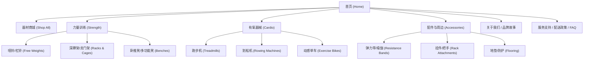

# 健身器材独立站 (Shopify) 详细需求规格说明书 (PRD)

## 1. 项目背景与目标定位

### 1.1 项目背景
本项目旨在基于 Shopify 平台，打造一个专注从事**健身与力量训练器材（Fitness & Gym Equipment）**的专业 DTC（Direct-to-Consumer）品牌独立站。产品线覆盖从居家轻量配件、可调节哑铃，到商用级全尺寸深蹲架（Full-size Racks）等跨规格、跨重量的大中小件器材。

### 1.2 商业与体验目标
1. **视觉调性**：极简现代（Clean & Modern）、充满力量感与激励感（Motivating），突出高分辨率的产品工业设计质感。
2. **转化体验**：针对健身器材差异化大（重量、尺寸、承重、运输）的特点，提供清晰的类目导航、参数对比、评价背书与阶梯运费结算体验。
3. **自主运营能力**：采用 Shopify Online Store 2.0 (OS 2.0) 模块化架构，赋能运营人员在无代码介入下独立更新库存、上线营销活动及调整首页布局。
4. **技术指标**：极速首屏加载（LCP < 2.5s）、移动端优先自适应、开箱即用的白帽 SEO 优化架构。

---

## 2. 目标用户画像与使用场景

| 用户类型 | 典型需求特征 | 核心痛点与关注点 | 关键功能触点 |
| :--- | :--- | :--- | :--- |
| **居家健身爱好者 (Home Gym)** | 关注空间占用、尺寸参数、多功能性、静音防刮 | 房间放不下、器材过重组装难、承重不达标 | 产品详细规格参数表、组装示意、真实买家秀/视频评价 |
| **重度力量训练者 / 健身工作室** | 关注钢材规格（如 11-gauge 钢管）、承重上限、稳定性、安全性 | 结构晃动、用料缩水、售后运费昂贵 | 承重专业认证、详细细节放大图、专业测评背书、大件物流保价 |
| **轻运动 / 瑜伽与康复人群** | 购买弹力带、瑜伽垫、筋膜枪、小件配重配件 | 选品混杂、凑单免运费门槛 | 搭配销售（Cross-sell / Upsell）、配件分类筛选、轻件包邮规则 |

---

## 3. 信息架构与导航体系 (Information Architecture)

### 3.1 导航栏与分类层级
1. **Header 核心菜单**：
   - **Strength**（力量区）：自由重量（Dumbbells / Barbells）、深蹲架（Racks / Cages）、综合训练器、卧推凳等。
   - **Cardio**（有氧区）：跑步机、划船机、风阻单车等。
   - **Accessories**（配件区）：训练地垫、杠铃片、保护带、弹力带等。
   - **Deals / Bundles**（促销/套装组合）：家庭健身房新手套装（Home Gym Starter Pack）。
2. **Mega Menu（超级菜单）**：一级分类支持图文联动的下拉展示，可在菜单内直接展示分类推荐图和热销款。
3. **智能搜索与筛选（Facet Filters）**：支持基于“重量规格”、“训练部位”、“材质/尺寸”、“价格区间”进行多维度实时筛选。

---

## 4. 详细功能需求 (Functional Specifications)

### 4.1 首页 (Homepage)
- **Hero Banner**：全宽高清大图/静音循环视频，搭配强有力的品牌 Slogan 及清晰的 CTA（如 "Shop Strength Equipment"）。
- **分类入口卡片 (Category Grid)**：视觉冲击力强的力量、有氧、配件快捷跳转卡片。
- **动态推荐区块 (Dynamic Featured Collections)**：
  - “新品首发 (New Arrivals)”
  - “爆款单品 (Best Sellers)”
  - “限时特惠 (Limited-time Offers)”
- **社交背书与用户评价走马灯 (Social Proof Carousel)**：展示 5 星满意度评价、健身达人使用实拍图及媒体报道徽章。
- **品牌信任模块 (Value Propositions)**：重点展示“商用级高强度钢材”、“终身结构质保”、“大件入户配送服务”、“30 天无忧试用”。

### 4.2 商品详情页 (Product Detail Page - PDP)
针对健身器材高单价、重参数的决策特点，PDP 为核心转化页面：
1. **多媒体展示矩阵**：
   - 支持多角度超清大图（滚轮放大或点击悬浮查看钢材焊接焊缝、滚花细节）。
   - 产品结构分解图与动作实操演示视频（嵌 YouTube/Vimeo 或 Shopify CDN 原生播放）。
2. **规格与变体选择器 (Variant Selectors)**：
   - 哑铃/配重片：按单重（5kg、10kg、20kg...）或成对规格切换，实时变动价格与库存。
   - 框架器材：按立柱尺寸、颜色（哑光黑/工业银）切换，即时联动对应图组。
3. **技术规格参数表 (Specs & Dimensions)**：
   - 结构化展示：组装尺寸 (长×宽×高)、净重/毛重、最大静止承重、主管材壁厚 (Gauge)、安装孔径等。
   - 提供尺寸示意图（含占地面积标注），解决用户“怕家里放不下”的疑虑。
4. **原生用户评价系统 (Reviews & Ratings)**：
   - 评分汇总栏：星级分布统计、好评率。
   - 图文/视频买家秀：带买家身材/使用场景标签（如 "Home Gym Owner"）。
   - 评论搜索与分类过滤（如按“稳定性”、“发货速度”过滤）。
5. **配送预估与大件提示 (Shipping Notice Widget)**：
   - 自动检测并提示“该商品属于大件重货，需专线托盘物流配送（Freight Shipping）”。
   - 邮编输入实时预估运费及送达时效。
6. **常见疑问折叠面板 (Accordion FAQs)**：保修政策、退换货条款、安装指南（支持下载 PDF 说明书）。

### 4.3 购物车与侧边抽屉 (Slide-out Cart & Cross-Sell)
- **Ajax 侧边抽屉购物车**：加购无需跳转，直接展开抽屉，提升连贯性。
- **免运费进度条 (Free Shipping Progress Bar)**：针对轻配件设立包邮门槛（如 “再消费 $50 即可享受小件免运费”）。
- **智能交叉销售 (Cross-sell / Bundling)**：购买杠铃架时，推荐配套杠铃杆、保护垫或安全扣。

### 4.4 结账流程与运费阶梯规则 (Checkout & Shipping Configuration)
*重点需求：解决小配件与超重大件的运费差异*
1. **多维度 Shipping Profile（运费策略组）**：
   - **标准轻件组 (Standard/Accessories)**：按单件/总重量设置常规快递（如 FedEx/UPS Ground），支持满额包邮。
   - **大件重货组 (Heavy & Bulky Equipment)**：50kg 以上框架、成套哑铃，走 LTL 托盘卡车货运（Freight / Curbside Delivery），按件或按大件阶梯阶梯定价，支持加购入户安装选项。
2. **全渠道主流支付网关 (Payment Gateways)**：
   - Shopify Payments / Stripe（集成 Visa, MasterCard, Amex）。
   - 快捷数字钱包：Apple Pay, Google Pay, Shop Pay（一键加速转化）。
   - 分期付款支持（针对数千美金的大件框架）：Klarna / Affirm / Afterpay（提升高客单转化率）。
   - PayPal Express Checkout。

### 4.5 运营管理与模块化后台 (Admin & Section Customization)
- 完全基于 **Shopify Online Store 2.0 (OS 2.0)** 标准开发，页面全面组件化（Sections everywhere）。
- 提供可视化自定义设置（Theme Customizer）：
  - 自由拖拽排序 Banner、图文模块、商品橱窗、公告栏（Announcement bar）。
  - 色彩管理预设：高对比度、力量感、极简白黑灰主调搭配活力强调色。
  - 活动促销倒计时横幅（Timer Bar）开关配置。

---

## 5. 非功能性需求 (Non-Functional Requirements)

### 5.1 性能与加载速度
- **首屏速度指标 (Core Web Vitals)**：LCP ≤ 2.5s, FID ≤ 100ms, CLS ≤ 0.1。
- 图片采用 WebP 格式自动化渐进加载，非首屏图片原生 `loading="lazy"`。
- 精简第三方 App 冗余脚本，使用原生 Liquid 优先实现基础交互，减少 Blocking JS。

### 5.2 移动端响应式体验 (Mobile-First)
- 适配各类屏幕分辨率（Mobile: 375px~430px, Tablet: 768px~1024px, Desktop: 1280px+）。
- 底部固定“立即加购 (Sticky Add-to-Cart)”工具栏，方便移动端快速下单。
- 触控优化的多图手势滑动组件。

### 5.3 SEO 搜索引擎友好度与结构化数据
- **Schema.org 结构化标记**：
  - Product Schema（价格、库存状态、聚合评分 `AggregateRating`、品牌 `Brand`、商品编码 `GTIN/SKU`）。
  - Organization & LocalBusiness Schema。
  - BreadcrumbList（面包屑导航结构）。
- 自动化生成合规 XML 站点地图 (`sitemap.xml`) 和 `robots.txt`。
- 全站语义化 HTML5 标签体系（H1-H3 层次规范，图片 Alt 自动适配商品名）。

---

## 6. 技术选型与生态配套建议

| 模块 | 推荐方案 | 选型理由 |
| :--- | :--- | :--- |
| **基础主题 (Base Theme)** | **Shopify Dawn 官方主题定制** 或 **Warehouse / Prestige** | Dawn 为官方开源现代核心，零臃肿、性能极致、完全符合 OS 2.0；若追求工业器材高级感，Prestige/Warehouse 具备成熟的重器械多变体展示能力。 |
| **评价系统 (Reviews)** | **Judge.me** 或 **Loox** | **Judge.me**：性能轻量（几乎不拖慢速度）、免费版功能丰富、支持 Google Rich Snippets 星级展现； **Loox**：视觉转化极佳，主打买家图文与视频评测。 |
| **搜索与多重筛选** | **Shopify Search & Discovery** | 官方原生出品，零额外订阅费用，深度集成 OS 2.0 筛选侧边栏，不损耗页面性能。 |
| **分期支付** | **Shop Pay Installments / Klarna** | 高客单价重型器械必备，分期降低购买门槛，通常可提升 20%~30% 的客单转化。 |
| **大件物流对接** | **Shopify Advanced Shipping Rules** | 针对不同重量阈值与尺寸，精准按件、按托盘、按邮区（Zone）配置运费。 |

---

## 7. 项目交付物与验收阶段 (Deliverables & Milestones)

### 7.1 核心交付物 (Deliverables)
1. **上线即用的全功能 Shopify 独立站**：
   - 具备完整前台导购、商品浏览、评价展示、加购、结账支付与邮件通知全流程。
2. **定制化主题源码与视觉资产包**：
   - 经过定制开发的 Shopify 主题代码包（含 Liquid / CSS / JS / JSON 模板文件）。
   - 契合健身品牌调性的高清水印图模版、Banner 规范图包、品牌调色板指南。
3. **运维与运营使用指南（SOP & 视频演示）**：
   - 交付实操录屏（Loom 视频）及图文文档：演示如何发布新器材、设置多变体参数、装修促销页面、导出与审核买家评价。

### 7.2 实施里程碑 (Milestones)

### 7.3 质量保障与验收测试清单 (QA Checklist)
- [ ] **响应式兼容性**：主流设备（iPhone、Android、iPad、MacBook、Windows PC）全分辨率断点无错位、溢出。
- [ ] **多变体与库存联动**：选择不同重量或颜色时，价格、SKU、图库、库存状态联动无延迟。
- [ ] **运费分流测试**：
  - 测试小件配件（如护腕/弹力带）：正确应用轻件快递规则并支持包邮。
  - 测试大件器材（如 100kg 深蹲架）：正确应用大件托盘物流费率。
  - 混合加购（大件 + 小件）：运费计算准确无冲突。
- [ ] **支付沙盒闭环**：通过 Shopify Bogus Gateway 或 Stripe Test Mode 跑通真实加购、扣款、弃单挽回、退款全流程。
- [ ] **评价数据与富文本展示**：测试评价提交、后台审核、前台富文本星级展示、Google 结构化测试工具无报错。
- [ ] **性能与代码审计**：Lighthouse / PageSpeed 性能评分达到 85+（Desktop）与 65+（Mobile）。

